# AWS Student Management System

## Step 1: AWS IAM - Create EC2 Role
Steps performed:

1. Opened AWS Console -> IAM -> Roles.

2. Clicked Create role.

3. Selected AWS service -> EC2 as the trusted entity.

4. Created role `StudentManagementEC2Role`.

5. Added tag: `Project = StudentManagementSystem`.

6. Left permissions empty for now.

Purpose:

To allow EC2 to securely access required AWS resources, such as the project's S3 bucket, without storing permanent access keys in the application.

Why no permissions?

 We will attach only the required S3 permissions after creating the bucket, instead of granting broad access.


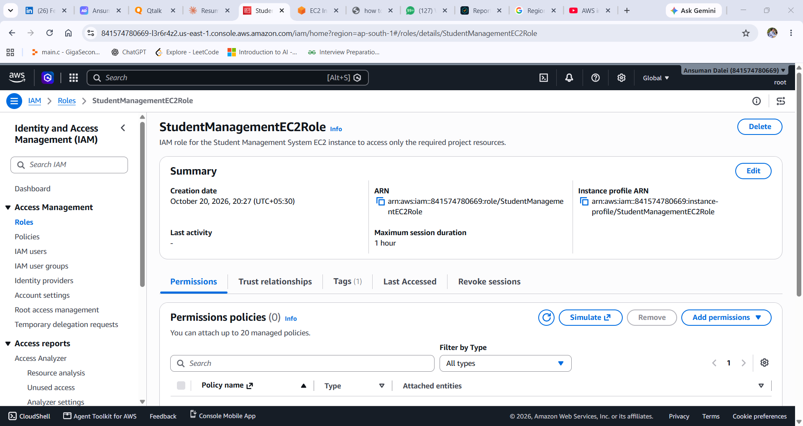

Status: Completed.

## Step 2: AWS VPC (Virtual Private Cloud)

### What is a VPC?
A VPC is a logically isolated virtual network in AWS. It allows us to organize AWS resources, control network traffic, and decide how resources communicate with each other.

### Steps Performed
1. Selected "VPC and more"

- What: Created the VPC along with networking resources.

- Why: It automatically creates components such as subnets, route tables, and an Internet Gateway, reducing manual configuration.

2. Set the VPC name to `student-management-vpc`

- What: Added a name to identify our project network.

- Why: Makes the VPC easy to find and distinguish from other AWS networks.

3. Set IPv4 CIDR to `10.0.0.0/16`

- What: Defined the private IP address range for the VPC.

- Why: AWS resources inside the VPC need IP addresses to communicate. This range provides a large address space for project subnets.

4. Selected 2 Availability Zones

- What: Distributed the subnets across two separate AWS Availability Zones.

- Why: Helps us learn a network design that can support higher availability if one zone has a problem.

5. Created 2 public subnets

- What: Created subnets intended for resources that need internet-facing connectivity.

- Why: Our Django web server on EC2 may need to receive web requests from users. Public access also requires correct routing, a public IP, and suitable security rules.

6. Created 2 private subnets

- What: Created subnets intended for backend resources.

- Why: The database is hosted on Amazon RDS for MySQL. See the RDS section below for the actual connectivity and security configuration.

7. Created and attached an Internet Gateway (IGW)

- What: Connected the VPC to an Internet Gateway.

- Why: It provides an internet traffic path for resources that have suitable routes and public IP configuration.

8. Created route tables and associated them with subnets

- What: Configured rules that determine where subnet network traffic should go.

- Why: Public subnet routes can direct internet-bound traffic to the Internet Gateway. Private subnet routes can be configured to keep resources from having a direct internet route.

9. Created an S3 Gateway endpoint

- What: Added a private network path from the VPC to Amazon S3.

- Why: Resources can access S3 without requiring a NAT Gateway for that traffic. The endpoint is also useful for practicing private AWS service connectivity.

10. Enabled DNS hostnames

- What: Allowed supported resources in the VPC to receive DNS hostnames.

- Why: DNS names make resources easier to identify and connect to than relying only on IP addresses.

11. Enabled DNS resolution

- What: Enabled DNS name resolution using the Amazon-provided DNS service.

- Why: Resources may need to resolve hostnames to IP addresses when connecting to other services.

12. Selected "No NAT Gateway"

- What: Did not create a NAT Gateway for private subnet internet access.

- Why: NAT Gateways have additional hourly and data-processing charges. We are avoiding this expense in our learning project.

### Why Do We Need a VPC in This Project?
Our Django application will run on EC2, and student data will be stored in Amazon RDS for MySQL. The VPC provides the network structure for these resources. We will use security groups to control which connections are allowed between the application server, database, and other resources.

### Screenshot

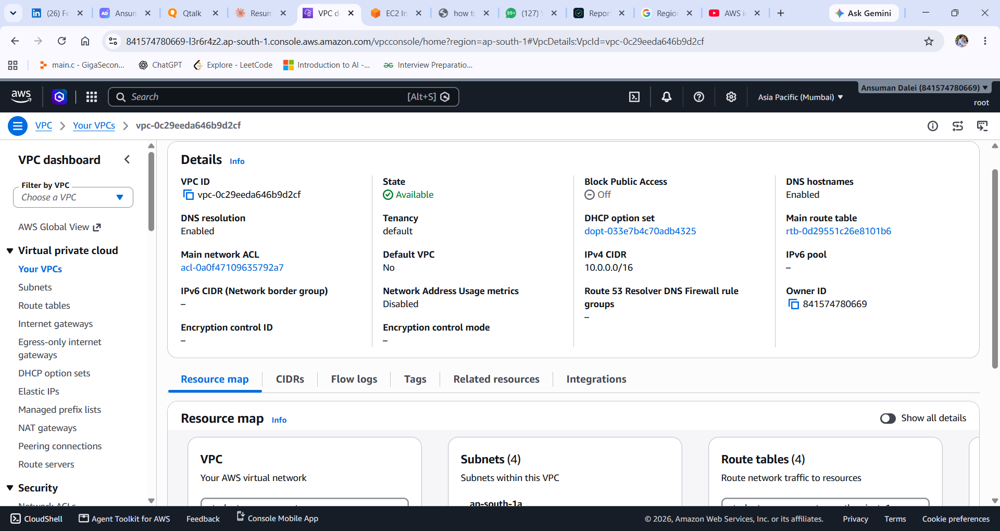

### Status
VPC and initial networking resources were created successfully. Security groups, EC2 deployment, and database connectivity will be configured and tested in later steps.

### Step 3: Create EC2 Security Group
What is a Security Group?

A Security Group acts as a virtual firewall that controls incoming and outgoing network traffic for AWS resources.

Steps performed:

1. Opened AWS Console -> VPC -> Security Groups.

2. Created a security group named `StudentApp-EC2-SG`.

3. Selected the project VPC, `student-management-vpc`.

4. Added an inbound HTTP rule on port `80` from `0.0.0.0/0`.

5. Added an inbound HTTPS rule on port `443` from `0.0.0.0/0`.

6. Kept the default outbound rule allowing all traffic.

Why did we use it?

- HTTP (80): Allows users to access the web application over HTTP.

- HTTPS (443): Allows secure web traffic when HTTPS is configured.

- Outbound rule: Allows the server to connect to required external services.

- SSH (22): Not added yet. We will configure restricted SSH access during EC2 setup.


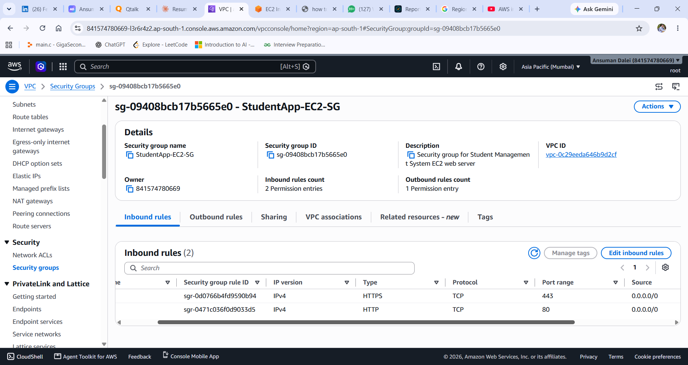

Status: Completed.

### Step 4: Launch EC2 Instance
What: Created an EC2 virtual machine named `StudentManagement-Server` using Amazon Linux 2023.

Configuration:

- Instance type: `t3.micro`

- VPC: `student-management-vpc-vpc`

- Subnet: `student-management-vpc-subnet-public1-ap-south-1a`

- Security group: `StudentApp-EC2-SG`

- IAM role: `StudentManagementEC2Role`

- Storage: 8 GiB gp3

- Key pair: `student-management-key`

Purpose: This instance will be used to host the Student Management System application during initial setup.

Architecture note: This instance was launched in a public subnet. We will review its role when setting up the Bastion Host and private application server.


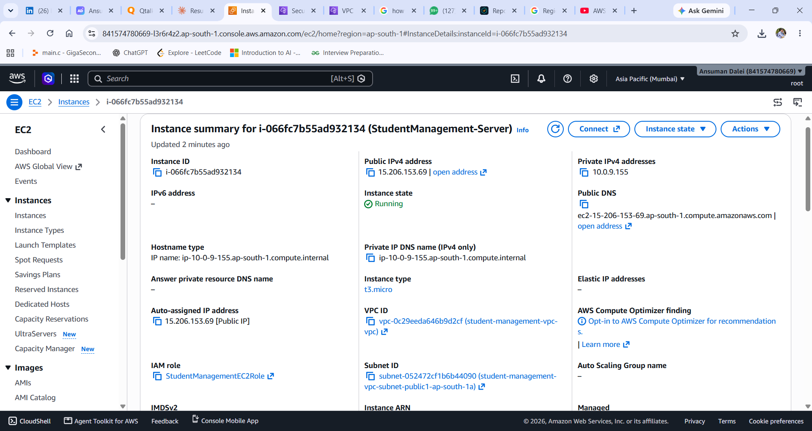

Status: Instance launched successfully and is running.

### Step 5: Create Bastion Host Security Group
What did we do?

Created a dedicated security group named `StudentManagement-Bastion-SG` in the project's VPC.

Configuration:

- Security Group ID: `sg-032cbcf2b41c94983`

- VPC ID: `vpc-0c29eeda646b9d2cf`

- Inbound rule: SSH, TCP port 22

- SSH source: `205.254.163.180/32`

- Outbound rules: Default outbound rule retained.

Why did we create it?

A security group acts as a virtual firewall for an EC2 instance. The Bastion Host needs SSH access so an administrator can securely connect to it.

Why allow SSH only from My IP?

The `/32` CIDR allows access from one specific IPv4 address. This reduces exposure compared with allowing SSH from every IP address (`0.0.0.0/0`).

How will we use it?

We will attach this security group to the Bastion Host in a public subnet. The Bastion Host will be the controlled entry point for SSH access to the private application server.


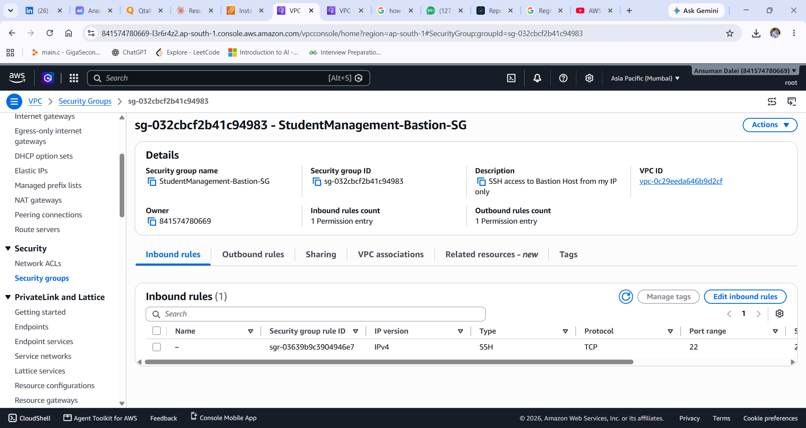

Status: Completed.

### Step 6: Launch Bastion Host EC2 Instance
What is a Bastion Host?

A Bastion Host is a specially configured server that provides a controlled entry point for securely accessing servers in private subnets.

What did we create?

We launched an EC2 instance named `StudentManagement-Bastion` in the public subnet of our project VPC.

Instance configuration:

| Setting | Value | Purpose |
|---|---|---|
| Instance name | `StudentManagement-Bastion` | Identifies the Bastion Host |
| Instance ID | `i-02c56aa4c2db13404` | Uniquely identifies the EC2 instance |
| Operating system | Amazon Linux 2023 | Provides the server environment |
| Instance type | `t3.micro` | Provides 2 vCPUs and 1 GiB RAM |
| VPC | `vpc-0c29eeda646b9d2cf` | Connects the instance to our project network |
| Subnet | `subnet-052472cf1b6b44090` | Places the Bastion Host in the public subnet |
| Public IPv4 | `13.127.116.254` | Allows administrative access from an authorized external IP |
| Private IPv4 | `10.0.4.148` | Enables communication inside the VPC |
| Security group | `StudentManagement-Bastion-SG` | Controls incoming and outgoing network traffic |
| SSH port | TCP 22 | Allows secure remote administration |
| SSH source | `205.254.163.180/32` | Restricts SSH access to one IPv4 address |
| Key pair | `student-management-key` | Authenticates SSH access |
| Storage | 8 GiB gp3 | Stores the operating system and required files |
| IAM role | None attached | No AWS service permissions are currently required for the Bastion Host |

Why did we create a Bastion Host?

The Bastion Host acts as a controlled entry point to our private application server. Instead of exposing the private server directly to the internet, an administrator first connects to the Bastion Host and then connects to the private server.

How will it work?

1. The administrator connects to the Bastion Host using SSH.

2. The Bastion Host forwards the administrative access path to the private application server through SSH.

3. The private server's security group will allow SSH from the Bastion Host's security group.

4. The Django application will be deployed on the application server, separately from the Bastion Host.

Security measures:

- SSH access is restricted to a specific IPv4 address.

- The Bastion Host uses a dedicated security group.

- The private application server will not need a public IP.

- The private SSH rule and connectivity must be configured before the Bastion Host can access the private server.


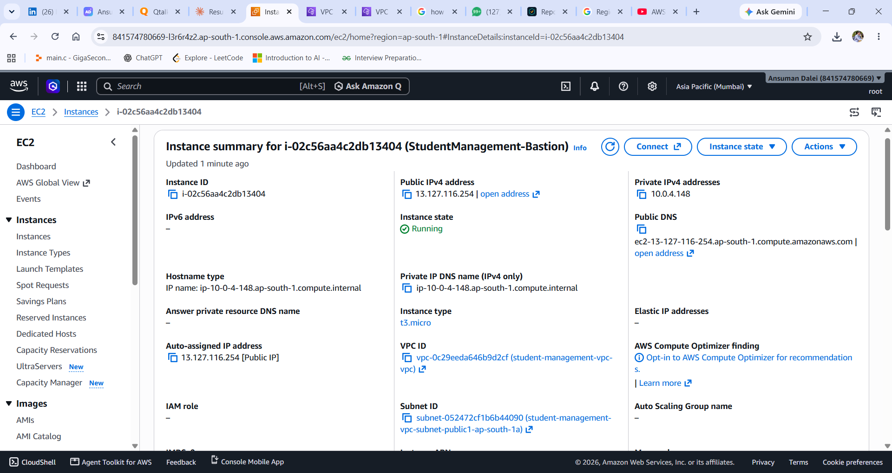

Status: Successfully launched and running.

### Step 7: Create Private Application Security Group
What did we create?

We created a security group named `StudentManagement-Private-App-SG` for the private application server.

Why did we create it?

To allow SSH access to the private application server only from the Bastion Host security group, instead of exposing SSH to the internet.

Inbound rule:

SSH, 22, `sg-032cbcf2b41c94983` (Bastion security group) |

Outbound rule: Default outbound traffic is allowed. We will restrict it further if required.

Security benefit: The private application server will not need a public IP, and SSH access will be controlled through the Bastion Host.


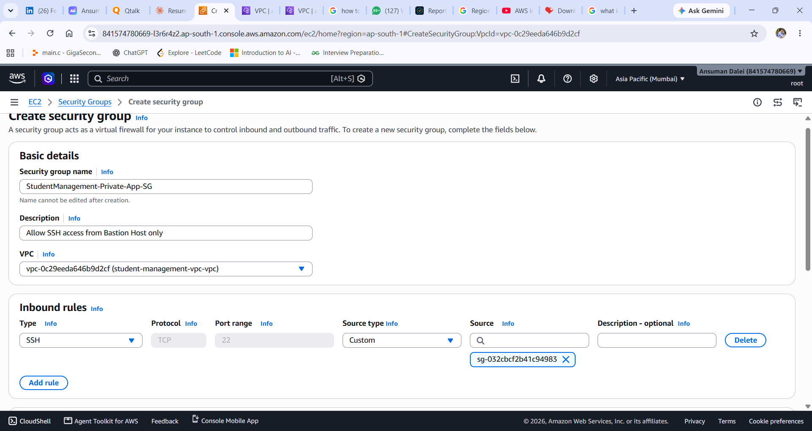

Status: Complete after the security group is created and verified.

### Step 8: Create S3 Bucket and Upload Static Website File
What did we create?

We created an Amazon S3 general-purpose bucket in the Mumbai Region (`ap-south-1`) for our Student Management System project.

Bucket name: `student-mgmt-static-ansuman-2026-841574780669-ap-south-1-an`

What did we upload?

We created a basic `index.html` file and uploaded it to the S3 bucket. The upload completed successfully with 1 file succeeded and 0 files failed.

Why did we do this?

Amazon S3 can store static website files such as HTML, CSS, JavaScript, and images. This is a learning exercise for the static website hosting topic from our AWS class.

Current status:

- S3 bucket created.

- Static website hosting enabled.

- `index.html` uploaded successfully.

- Bucket policy configured and static website access verified successfully.

Security note: The bucket must contain only demo website files if public access is enabled. Do not upload student records, passwords, or other sensitive information.


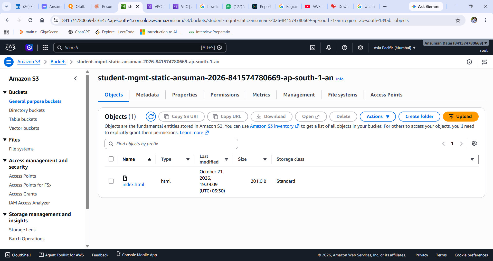

### Step 9: Configure S3 Public Access for Static Website
What did we configure?

We turned off the bucket-level Block all public access setting for our S3 static website demonstration.

Why did we configure it?

Our static website requires public visitors to read website files. A bucket policy will be used to grant only the required read permission.

Security note: This bucket is intended for demo website files only. Do not upload passwords, student records, or other sensitive information.

Current status: Block all public access is Off, the public-read bucket policy is configured, and the static website was verified.


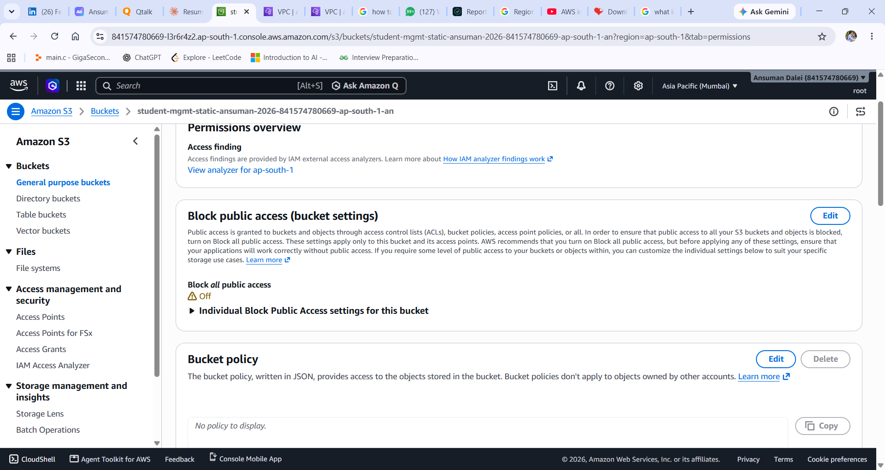

### Step 10: Configure S3 Bucket Policy
What did we configure?

We added a bucket policy to allow public read access to objects in our static website bucket.

Permission granted: `s3:GetObject`

Why did we configure it?

Public visitors need permission to read the static website files. The policy does not grant public upload or delete access.

Security note: Only demo website files should be stored in this publicly readable bucket. Sensitive data must not be uploaded.


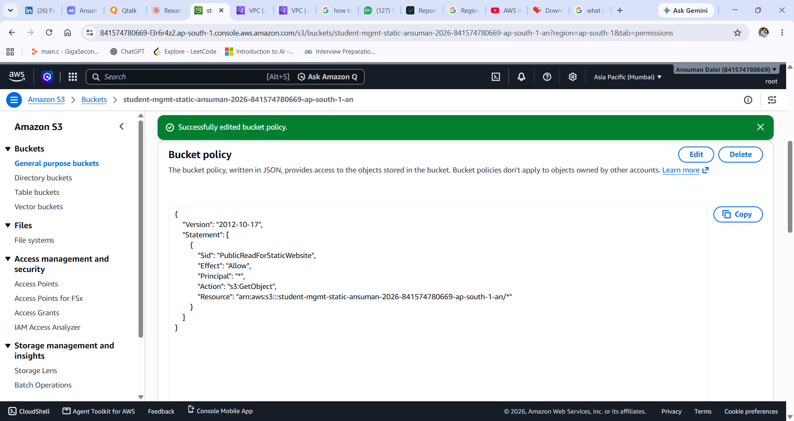

Status: Mark complete after successfully saving and verifying the policy.

### Step 11: Verify S3 Static Website
What did we do?

We opened the Amazon S3 static website endpoint in a browser and verified that the uploaded `index.html` file loads successfully.

Why did we do this?

This confirms that static website hosting is enabled and the bucket policy allows visitors to read the website files.

Result: The Student Management System demo page opened successfully in the browser.

Security note: The website uses the S3 website endpoint over HTTP. Only public demo content should be stored in this bucket. Do not upload student records, passwords, or other sensitive information.


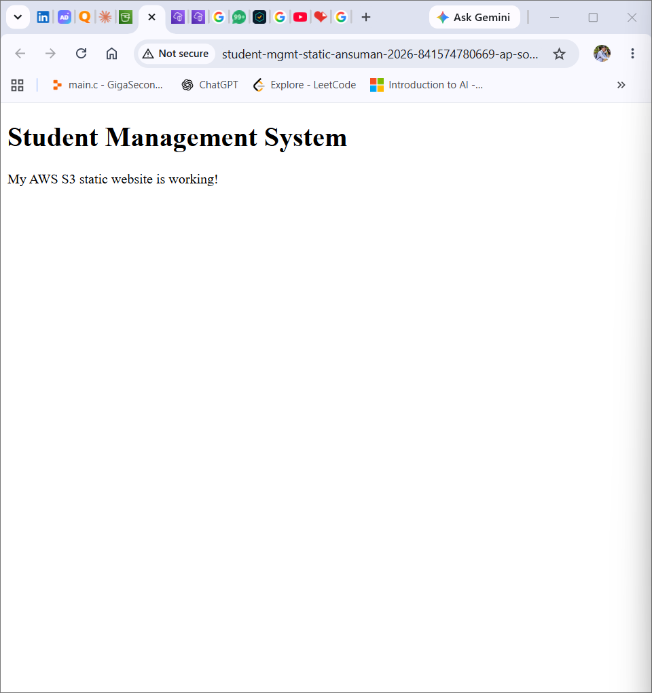

Status: Completed successfully.

### Step 12: Configure EC2 IAM Role for S3 Access
What did we configure?

We attached an inline IAM policy named `StudentManagementS3AccessPolicy` to `StudentManagementEC2Role`.

Permissions granted:

- `s3:ListBucket` - list objects in the project bucket.

- `s3:GetObject` - read objects.

- `s3:PutObject` - upload objects.

Why did we configure it?

The EC2 application server can access the required S3 bucket through its IAM role, without hardcoding AWS access keys in application code.

Security benefit: Access is restricted to the project bucket, with no full S3 or Administrator permissions.


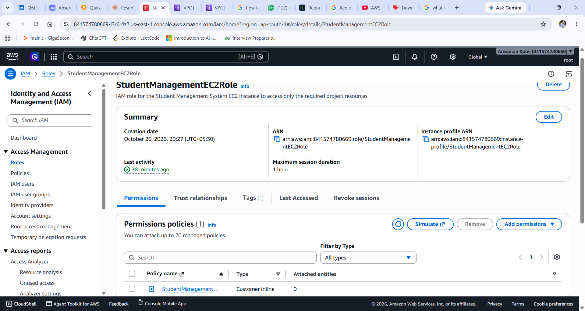

Status: Complete after confirming the policy is attached to the role.

### Step 13: Create an IAM User and Attach a Policy Directly
What did we create?

We created an IAM user named `student-management-lab-user` for practicing AWS console access and IAM permissions.

Policy attached: `ReadOnlyAccess` (AWS managed policy).

Why did we do this?

This practical demonstrates how an IAM policy can be attached directly to a user to control which AWS actions the user is allowed to perform.

Permissions: The `ReadOnlyAccess` policy provides broad read-only access to supported AWS services. It does not grant normal write or delete permissions, although some actions and services may have exceptions.

Security note: The user should use a strong password and change it at first sign-in where required. Credentials must not be committed to GitHub or included in screenshots.


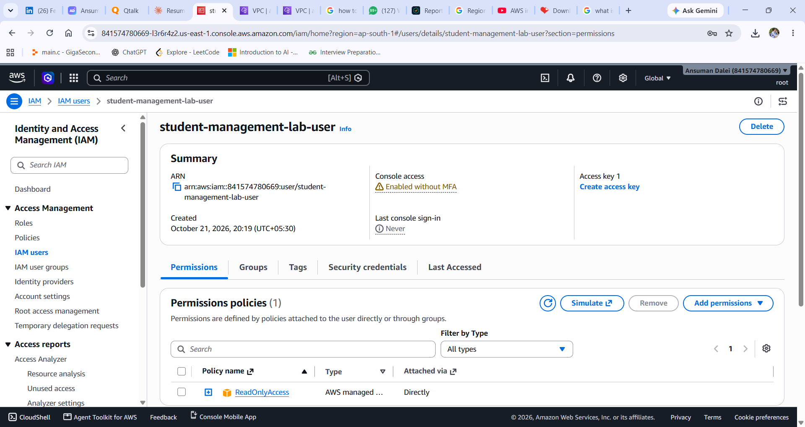

Status: Complete after confirming the IAM user was created successfully.

### Step 14: Create an IAM Group and Attach a Policy
Group name: `StudentManagement-Developers`

Policy attached: `ReadOnlyAccess`

What did we do?

Created an IAM group and attached the AWS-managed `ReadOnlyAccess` policy.

Why did we do this?

IAM groups make permission management easier. Instead of assigning the same permissions separately to multiple users, we can assign permissions to a group and add users to it.

Security: We use read-only access for this learning user instead of unnecessary administrator permissions.


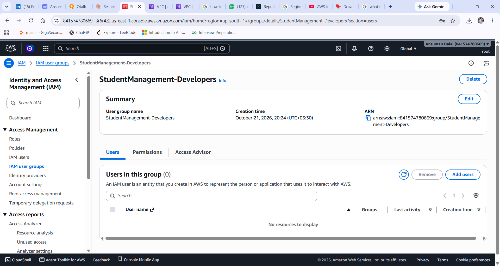

Status: Complete after confirming the group and policy are visible in IAM.

### Step 15: Add IAM User to the Group
User: `student-management-lab-user`

Group: `StudentManagement-Developers`

What did we do?

Added the IAM user to the `StudentManagement-Developers` group.

Why did we do this?

Users inherit permissions granted to their groups. Group-based permissions make it easier to manage access for multiple users.


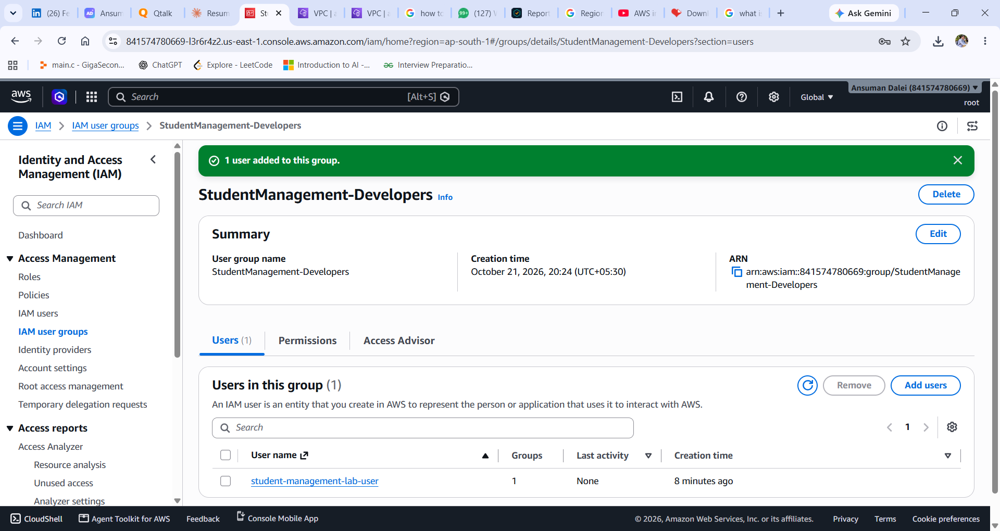

Status: Complete after verifying the user appears in the group's Users tab.

### Step 16: Test IAM User Console Login
IAM user: `student-management-lab-user`

What did we do?

Tested AWS Management Console access using the IAM user's own credentials.

Why did we do this?

This verifies that the IAM user can sign in independently of the root user.

Permission model: The user receives `ReadOnlyAccess` through the `StudentManagement-Developers` group. Effective permissions may also depend on other policies and account-level restrictions.

Security: Never store passwords or access keys in the repository or screenshots.


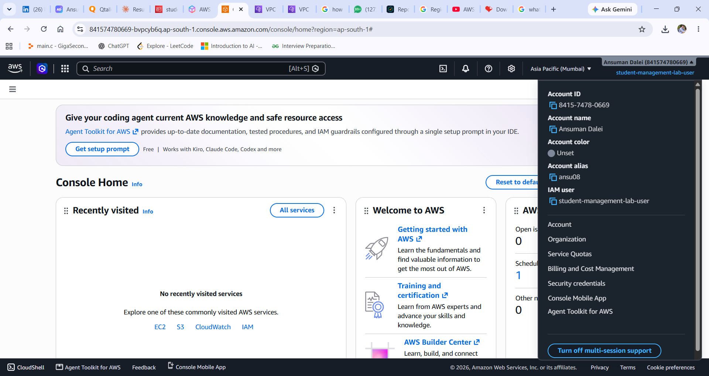

Status: Complete after successful login verification.

## Step 17: Prepare Django for Amazon S3 Integration

### 17.1 Install Required Packages
Packages installed:

- `django-storages` - integrates Django with external storage services such as Amazon S3.

- `boto3` - AWS SDK for Python, used by Django storage integration to communicate with AWS services.

Command:

```powershell

python -m pip install django-storages boto3

```

Why?

Django needs the appropriate storage backend and AWS SDK to store uploaded files in Amazon S3.

### 17.2 Inspect Django Settings
File: `config/settings.py`

Checked the existing `INSTALLED_APPS`, database, static-file and media-file settings before making changes.

Existing configuration:

- Database: MySQL

- Local media directory: `media/`

- Static URL: `static/`

Why?

Checking the existing configuration helps avoid breaking student registration, profile-photo uploads or other application features.

### 17.3 Register the Storage Application
Added `'storages'` to `INSTALLED_APPS` in `config/settings.py`.

Why?

This registers the Django storage integration application.

Note: Registering the application alone does not complete S3 storage integration.

### 17.4 Install Environment Variable Support
Package: `python-dotenv`

```powershell

python -m pip install python-dotenv

```

Why?

Environment variables allow sensitive configuration to be kept outside the source code.

### 17.5 Create the Local Environment File
Created `.env` in the project root:

```text

C:\student_management_fixed\\.env

```

Generated a Django secret key locally and stored it in the environment file as `DJANGO_SECRET_KEY`.

Security: The secret key must not be committed to GitHub or shared publicly.

### 17.6 Load Environment Variables
File: `config/settings.py`

```python

from pathlib import Path

import os

from dotenv import load_dotenv

BASE_DIR = Path(__file__).resolve().parent.parent

load_dotenv(BASE_DIR / ".env")

```

The existing `BASE_DIR` definition must appear before `load_dotenv()` uses it.

Why?

Django needs to load environment variables before reading settings that depend on them.

### 17.7 Protect Environment Files
Verified that `.gitignore` includes:

```gitignore

.env

```

Why?

This prevents the local environment file from being included in normal Git commits.

Security note: Verify Git status before pushing. If a secret was previously committed, adding `.env` to `.gitignore` alone does not remove it from Git history.

### 17.8 Validate the Django Project
Command:

```powershell

python manage.py check

```

Result: System check completed without issues.

Why?

This checks Django configuration for common errors before continuing with integration.

### Django and Private S3 Integration - Completed
Configured Django's storage backend to use the designated private S3 bucket for student profile photos. Verified EC2 IAM role permissions and tested photo uploads and display.

Current status: Django configuration check passed. Student photos were uploaded to private S3 and verified in the application.

## Step 18: Create a Private S3 Bucket for Student Photos
Service: Amazon S3  

Region: Asia Pacific (Mumbai), `ap-south-1`  

Bucket: `student-mgmt-photos-an-841574780669-ap-south-1-an`

### What did we do?
Created a separate S3 bucket intended for student profile-photo uploads.

### Why did we do this?
Student photos are application data and should not be publicly accessible. A separate private bucket keeps these files separate from the public static website used for the S3 demonstration.

### Security configuration
- Block Public Access: All four settings enabled.

- Object Ownership: ACLs disabled.

- Default encryption: SSE-S3.

- No public bucket policy.

- Student photos must not be uploaded to the public website bucket.

### How will it work?
Django will use the S3 storage backend to upload student photos. On EC2, the application will use its attached IAM role rather than hardcoded AWS access keys.

### Screenshot

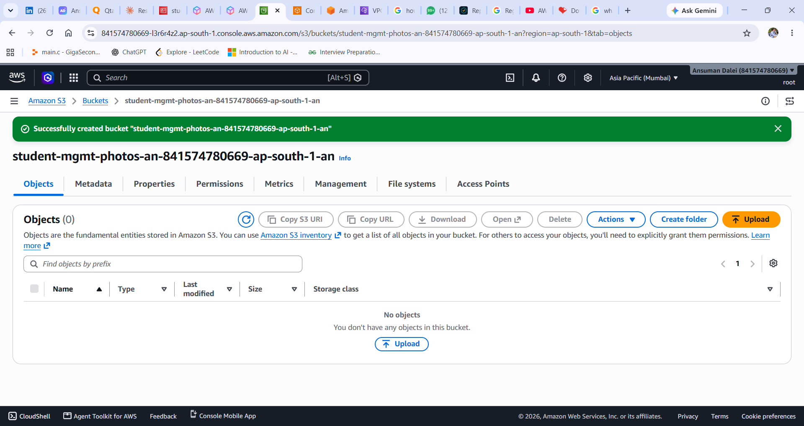

Status: Private bucket created with public access blocked. Django photo uploads and retrieval were tested successfully.

## Step 19: Update EC2 IAM Role for Private S3 Access

### What did we do?
Updated the existing `StudentManagementS3AccessPolicy` attached to `StudentManagementEC2Role` to allow access to the dedicated private student-photos bucket.

Private bucket: `student-mgmt-photos-an-841574780669-ap-south-1-an`

### Permissions added

| Permission | Purpose |
|---|---|
| `s3:ListBucket` | List objects in the designated bucket |
| `s3:GetObject` | Read student photo objects |
| `s3:PutObject` | Upload student photo objects |
| `s3:DeleteObject` | Delete photo objects when required |

### Why did we do this?
The Django application will need permission to upload and retrieve student photos from Amazon S3 when running on EC2. An attached IAM role provides temporary AWS credentials without hardcoding access keys in the application.

### Security
- Permissions are limited to the designated student-photo bucket.

- The student-photo bucket must keep Block Public Access enabled.

- The existing public static website bucket remains separate.

- IAM permissions alone do not make the private bucket public.

### Screenshot

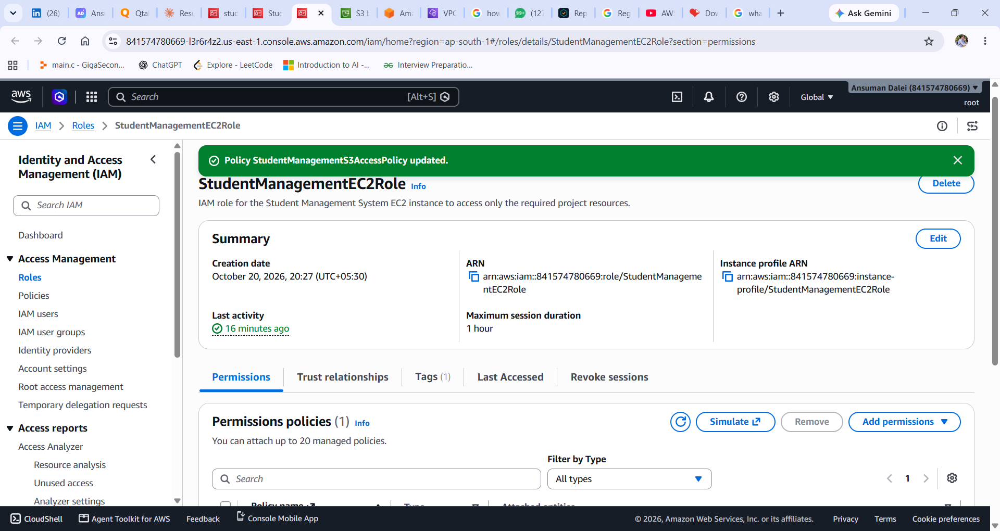

Status: IAM policy updated. EC2 access to the private S3 bucket and Django photo uploads were verified.

## Step 20: Configure Private S3 Bucket for Student Photos
What: Configured the Django project to use the private S3 bucket for student profile photos.

Why: Student profile photos should not be stored in a publicly accessible website bucket.

How: Updated `AWS_STORAGE_BUCKET_NAME` and `AWS_S3_REGION_NAME` in `config/settings.py`.

Security: AWS credentials are not hardcoded in the source code. The EC2 instance will use its IAM role for AWS access.

Status: Django is configured to use the private S3 bucket. Student photo uploads and display were verified successfully.

## Step 21: Connect to Private EC2 Using Bastion Host

### What is a Bastion Host?
A Bastion Host is an EC2 instance used as an entry point to securely access another EC2 instance using its private IP address.

### Why did I use it?
I used the Bastion Host to connect to the Student Management Server through its private IP address instead of connecting to it directly.

### Configuration

| Resource | Details |
|---|---|
| Bastion Host | StudentManagement-Bastion |
| Bastion Private IP | `10.0.4.148` |
| Student Management Server | StudentManagement-Server |
| Server Private IP | `10.0.9.155` |
| Operating System | Amazon Linux 2023 |
| SSH Port | 22 |

### Steps Performed
1. Opened the AWS EC2 Console.

2. Connected to `StudentManagement-Bastion` using EC2 Instance Connect.

3. Prepared the SSH private key file on the Bastion Host.

4. Set the key file permissions using `chmod 400`.

5. Connected to the Student Management Server using SSH:

   ```bash

   ssh -i \~/.ssh/student-management-key.pem ec2-user@10.0.9.155

   ```

6. Verified the connection using:

   ```bash

   hostname

   hostname -I

   ```

7. Confirmed the target server's private IP address was `10.0.9.155`.

### Result
Successfully connected from the Bastion Host to the Student Management Server using SSH and its private IP address.

### What I Learned
- How to connect to an EC2 instance using EC2 Instance Connect.

- How to connect from one EC2 instance to another using SSH.

- How to use a private IP address for SSH connectivity.

- Why SSH key files require appropriate permissions.

### Screenshot
Save the screenshot showing the successful SSH connection and the `hostname -I` output as:


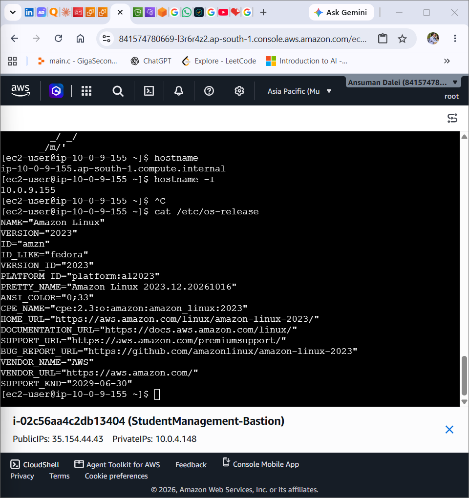

Security Note: The private key was used for SSH authentication. It must not be shared publicly or committed to GitHub.

## Step 22: Configure CloudWatch CPU Alarm and SNS Notification

### What is CloudWatch?
Amazon CloudWatch monitors AWS resources and collects metrics such as EC2 CPU utilization.

### Why did I use CloudWatch?
- To monitor the CPU utilization of the EC2 instance.

- To create an alarm when CPU usage exceeds the configured threshold.

- To send email notifications through Amazon SNS.

### Configuration
- Service: Amazon CloudWatch

- Monitored instance: StudentManagement-Server

- Metric: CPUUtilization

- Statistic: Average

- Period: 5 minutes

- Threshold: Greater than 50%

- Alarm name: StudentManagement-CPU-High

- Notification service: Amazon SNS

- SNS topic: StudentManagement-CPU-Alerts

### How it works
1. CloudWatch monitors the EC2 instance's CPU utilization.

2. The alarm checks whether average CPU utilization exceeds 50% over the configured evaluation period.

3. When the alarm enters the In alarm state, it sends a notification to the configured SNS topic.

4. A confirmed email subscription is required to receive email notifications.

### Screenshot
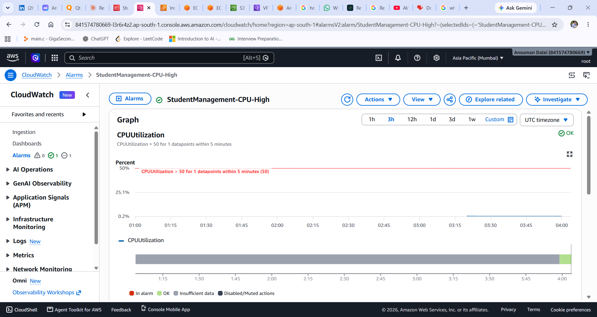

### Interview Explanation
I configured an Amazon CloudWatch alarm to monitor EC2 CPU utilization. I set a 50% threshold with a five-minute period and configured Amazon SNS for email notifications when the alarm enters the In alarm state.

### SNS Email Subscription Verification
What is Amazon SNS?

Amazon Simple Notification Service (SNS) sends notifications to subscribed endpoints, such as email addresses.

Configuration

- SNS topic: `StudentManagement-CPU-Alerts`

- Protocol: Email

- Subscription status: Confirmed

How it works

1. CloudWatch sends a notification to the configured SNS topic when the alarm enters the `In alarm` state.

2. SNS delivers the notification to the confirmed email subscription.

3. The email subscription must be confirmed before email notifications can be received.

Screenshot

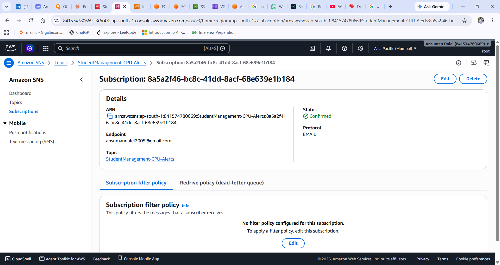

## Step 23: Manage EC2 Instances Using AWS Lambda

### 21.1 Objective
The objective of this practical is to use AWS Lambda to start an EC2 instance without manually starting it from the EC2 console.

AWS Lambda is a serverless compute service that executes code in response to an event or request.

### 21.2 Create an IAM Role for Lambda
Created an IAM role named `StudentManagement-Lambda-EC2-Role`.

Role details:

- Role name: `StudentManagement-Lambda-EC2-Role`

- Trusted entity: AWS service

- Use case: Lambda

- Description: Allows AWS Lambda to manage EC2 instances for the Student Management project.

Permissions attached:

1. `AmazonEC2FullAccess`

2. `EC2InstanceConnect`

These permissions were attached according to the practical instructions. `AmazonEC2FullAccess` grants broad EC2 permissions; a production project should use a more restrictive policy that allows only the required actions on the intended instance.


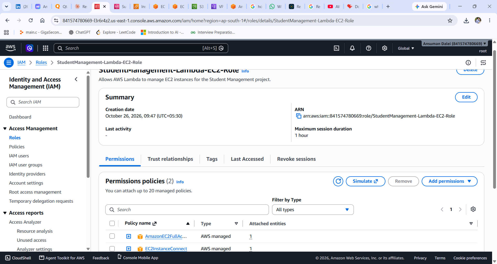

### 21.3 Create the Lambda Function
Created a Lambda function to control the EC2 instance.

Function configuration:

- Function name: `StudentManagement-EC2-Controller`

- Creation method: Author from scratch

- Runtime: Python 3.13

- Architecture: x86_64

- Execution role: `StudentManagement-Lambda-EC2-Role`

- AWS Region: `ap-south-1` (Asia Pacific - Mumbai)

Function ARN:

`arn:aws:lambda:ap-south-1:841574780669:function:StudentManagement-EC2-Controller`

Screenshot: [Open Lambda EC2 IAM role](screenshot/22-lambda-ec2-iam-role.png)

### 21.4 Configure General Settings
Opened the Lambda function's Configuration tab and configured the general settings.

- Description: `Manages EC2 instances for the Student Management project.`

- Timeout: 15 seconds

- Memory: 128 MB

- Execution role: `StudentManagement-Lambda-EC2-Role`

The timeout determines how long Lambda is allowed to execute before it stops the invocation.

Screenshot: [Open Lambda EC2 IAM role](screenshot/22-lambda-ec2-iam-role.png)

### 21.5 Write the Python Code
Opened the Lambda function's Code tab and replaced the default code with the following Python code.

```python

import boto3

def lambda_handler(event, context):

    ec2 = boto3.client('ec2', region_name='ap-south-1')

    instance_id = 'i-066fc7b55ad932134'

    response = ec2.start_instances(

        InstanceIds=[instance_id]

    )

    print('Started EC2 instance:', instance_id)

    return response

```

Code explanation:

1. `import boto3` imports the AWS SDK for Python.

2. `lambda_handler(event, context)` is the function AWS Lambda executes.

3. `boto3.client('ec2', region_name='ap-south-1')` creates an EC2 client for the Mumbai region.

4. `instance_id` stores the ID of the `StudentManagement-Server` instance.

5. `ec2.start_instances()` sends a request to start the specified EC2 instance.

6. `print()` writes the instance ID to the execution logs.

7. `return response` returns the response received from AWS.

Screenshot: [Open Lambda EC2 IAM role](screenshot/22-lambda-ec2-iam-role.png)

### 21.6 Deploy the Code
After entering the Python code, clicked Deploy in the Lambda Code tab.

AWS confirmed that the function was updated successfully.

Deploying saves the code version used by subsequent test invocations.

Screenshot: [Open Lambda EC2 IAM role](screenshot/22-lambda-ec2-iam-role.png)

### 21.7 Create a Test Event
Created a test event to execute the Lambda function.

- Test event name: `StartEC2Test`

- Event JSON:

```json

{}

```

- Invocation type: Synchronous

- Event sharing: Private

The empty JSON object is sufficient because the Python code does not read any values from the event.

Saved the test event before executing it.


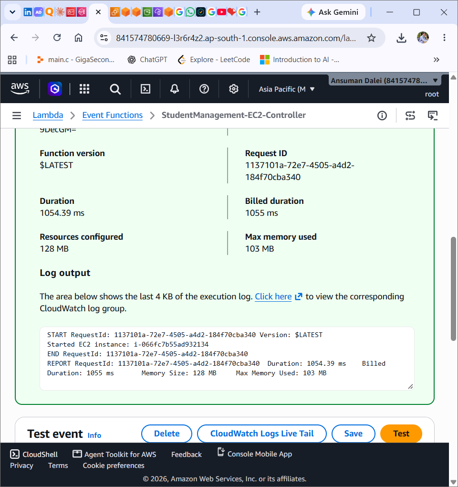

### 21.8 Execute the Test
Selected the `StartEC2Test` event and clicked Test.

AWS Lambda displayed a successful execution result.

Execution details observed:

- Duration: 1054.39 ms

- Billed duration: 1055 ms

- Memory configured: 128 MB

- Maximum memory used: 103 MB

- Function version: `$LATEST`

The execution log displayed:

```text

START RequestId: 1137101a-72e7-4505-a4d2-184f70cba340 Version: $LATEST

Started EC2 instance: i-066fc7b55ad932134

END RequestId: 1137101a-72e7-4505-a4d2-184f70cba340

REPORT RequestId: 1137101a-72e7-4505-a4d2-184f70cba340 Duration: 1054.39 ms Billed Duration: 1055 ms Memory Size: 128 MB Max Memory Used: 103 MB

```

Screenshot: [Open Lambda EC2 start test](screenshot/23-lambda-ec2-start-test.png)

### 21.9 Verify the EC2 Instance
Opened the EC2 console and checked the state of `StudentManagement-Server`.

- Instance ID: `i-066fc7b55ad932134`

- Expected state after starting: `Running`

The Lambda execution log confirms that the function ran and printed the target instance ID. The EC2 console state should also be checked to verify the instance's actual status.

Screenshot: [Open Lambda EC2 start test](screenshot/23-lambda-ec2-start-test.png)

### 21.10 Result
Successfully created the `StudentManagement-EC2-Controller` Lambda function, configured its execution role, added the Python code, deployed the code, and executed the `StartEC2Test` event.

The Lambda execution succeeded and logged the target EC2 instance ID. The EC2 console state is checked separately to confirm that the instance is running.

Learning outcome: Learned how IAM roles provide permissions to Lambda, how Lambda uses Boto3 to call the EC2 API, and how to deploy, test, and inspect Lambda execution logs.

### Step 24: Send Email Notifications Using AWS Lambda and SNS
Objective: Send an email notification using AWS Lambda and Amazon SNS.

1. Create Lambda Function

- Function name: `StudentManagement-SNS-Notification`

- Runtime: Python 3.13

- Architecture: x86_64

- Region: `ap-south-1`

- Execution role: `StudentManagement-Lambda-EC2-Role`

2. Configure IAM Permissions

Added an inline policy named `StudentManagement-SNS-Publish-Policy` to allow the Lambda function to publish messages to the existing SNS topic `StudentManagement-CPU-Alerts`.

3. Verify SNS Topic

Used the existing SNS topic:

- Topic name: `StudentManagement-CPU-Alerts`

- Email subscription status: Confirmed

4. Add Python Code

```python

import boto3

import os

sns = boto3.client('sns', region_name='ap-south-1')

def lambda_handler(event, context):

    response = sns.publish(

        TopicArn='arn:aws:sns:ap-south-1:841574780669:StudentManagement-CPU-Alerts',

        Subject='Lambda Test Notification',

        Message='Hello! This is a test email notification from AWS Lambda.'

    )

    print('SNS Message ID:', response['MessageId'])

    return {

        'statusCode': 200,

        'body': 'SNS email notification sent successfully'

    }

```

5. Create Test Event

- Test event name: `SNSEmailTest`

- Event JSON: `{}`

6. Execute the Test

Clicked Test in the Lambda console.

Observed result:

- Status: `Succeeded`

- Response status code: `200`

- Message: `SNS email notification sent successfully`

- SNS Message ID: `7f3d8a51-a9a7-5343-a6da-e9094a458e08`

- Duration: `315.02 ms`

- Billed duration: `824 ms`

- Memory size: `128 MB`

- Maximum memory used: `88 MB`


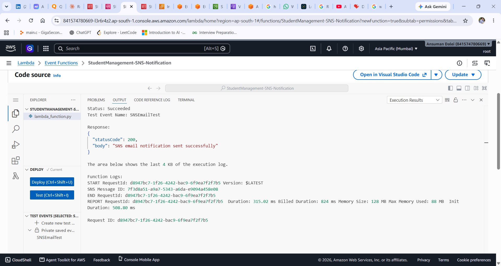

Result: Successfully invoked Lambda to publish a test message to the confirmed SNS topic. Check the email inbox to verify delivery.

Learning outcome: Learned how Lambda uses Boto3 to publish a message to an SNS topic and how to test the function using a Lambda test event.

## Amazon RDS MySQL - Step-by-Step Practical

### 1. Introduction
Amazon Relational Database Service (Amazon RDS) is an AWS service used to create and manage relational databases in the cloud.

In this practical, I created a MySQL database instance in Amazon RDS and connected to it using MySQL Workbench.

Purpose: To demonstrate that the cloud-hosted MySQL database is accessible and can execute SQL queries successfully.

### 2. Database Configuration
The following configuration was used:

| Setting | Value |
|---|---|
| AWS Region | Asia Pacific (Mumbai) - ap-south-1 |
| DB Instance Identifier | student-management-db |
| Database Engine | MySQL |
| Database Version | MySQL 8.4.11 |
| Master Username | admin |
| DB Instance Class | db.t4g.micro |
| Storage Type | General Purpose SSD (gp2) |
| Allocated Storage | 20 GiB |
| Deployment | Single-AZ |
| Database Name | studentdb |

Note: Confirm these values against the final RDS instance details if any setting changed during creation.

### 3. Creating the RDS Instance
1. Open the AWS Management Console.

2. Select the Mumbai region (ap-south-1).

3. Open Amazon RDS and select Databases.

4. Click Create database.

5. Select MySQL as the database engine.

6. Enter `student-management-db` as the DB instance identifier.

7. Set the master username to `admin` and configure a strong password.

8. Select the appropriate instance class and storage.

9. Review connectivity, backup, encryption and monitoring settings.

10. Create the database and wait until its status becomes Available.

Why is this required?

The RDS instance hosts the MySQL database on AWS. The Available status indicates that the instance is ready for use.


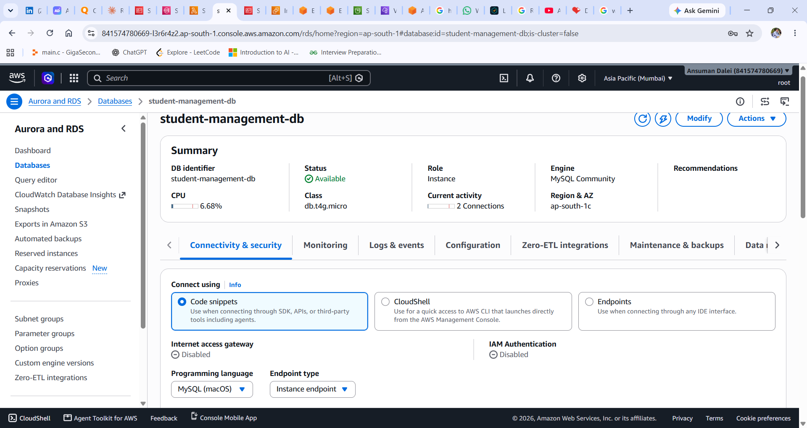

### 4. Connectivity and Security
The database was configured to allow a MySQL Workbench connection.

Important connection details:

- Endpoint: Copy from RDS -> Connectivity & security.

- Port: 3306.

- Username: admin.

- Password: The master password configured for the instance.

The attached security group must allow inbound MySQL traffic on port 3306 only from the required trusted IP address.

Security note: Do not allow MySQL traffic from `0.0.0.0/0`. Public accessibility should be enabled only when required for the practical and must be restricted by security group rules.

Screenshot: [Open RDS MySQL instance](screenshot/rds-instance.png)

### 5. Connecting with MySQL Workbench
1. Open MySQL Workbench.

2. Create a new connection.

3. Enter a connection name, such as `Student Management RDS`.

4. Enter the RDS endpoint as the hostname.

5. Set the port to `3306`.

6. Enter `admin` as the username.

7. Enter the correct master password.

8. Click Test Connection.

9. Open the connection after the test succeeds.

Result: MySQL Workbench successfully connected to the AWS RDS MySQL instance.

Screenshot: [Open RDS MySQL instance](screenshot/rds-instance.png)

### 6. Checking Available Databases
Execute:

```sql

SHOW DATABASES;

```

Explanation: Lists the databases available on the connected MySQL server.

### 7. Selecting the Project Database
Execute:

```sql

USE studentdb;

```

Explanation: Selects `studentdb` as the current database for subsequent SQL commands.

### 8. Creating the Students Table
The following SQL creates a table to store sample student information:

```sql

CREATE TABLE students (

    id INT PRIMARY KEY AUTO_INCREMENT,

    name VARCHAR(100),

    course VARCHAR(100)

);

```

Explanation:

- `id`: Unique identifier for each record.

- `PRIMARY KEY`: Uniquely identifies each student record.

- `AUTO_INCREMENT`: Automatically generates the next ID.

- `name`: Stores the student's name.

- `course`: Stores the student's course.

### 9. Inserting Sample Student Records
Execute:

```sql

INSERT INTO students (name, course)

VALUES

('Ansuman', 'B.Tech CSE'),

('Rahul', 'Python');

```

Explanation: Inserts two sample records into the `students` table.

Result: MySQL Workbench reported that two rows were affected.

### 10. Verifying the Table and Records
Check the available tables:

```sql

SHOW TABLES;

```

Display the inserted records:

```sql

SELECT * FROM students;

```

Explanation: `SHOW TABLES` lists the tables in the selected database. `SELECT * FROM students` displays all columns and records from the students table.

Expected result:

| ID | Name | Course |
|---:|---|---|
| 1 | Ansuman | B.Tech CSE |
| 2 | Rahul | Python |

Result: Two student records were returned successfully.

Screenshots:


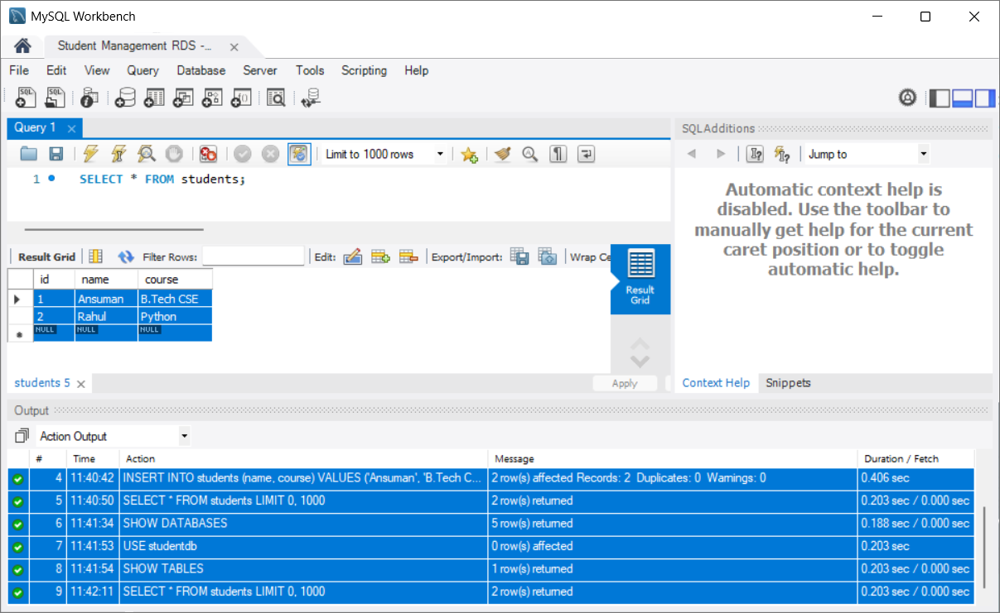

Screenshot reference: [Open RDS student records](screenshot/rds-student-records.png)

### 11. Troubleshooting Connection Errors
An `Access denied for user` error can occur when the username or password is incorrect.

Troubleshooting performed:

1. Verified that the master username was `admin`.

2. Checked the saved password in MySQL Workbench.

3. Reset the master password in RDS when required.

4. Retested the connection using the correct credentials.

Security note: Never include the actual database password in this README.

### 12. Cost Management and Cleanup
Amazon RDS can incur charges while the database is running. Storage and other resources may continue to incur charges even if an instance is stopped.

Before and after practical sessions:

1. Check the RDS instance and related resource status.

2. Review the AWS Billing and Cost Management console for actual charges and estimates.

3. Stop or delete resources only when appropriate for the project.

4. Take care before deleting a database because deletion can remove project data.

### 13. Final Verification
The following tasks were completed:

- Created an Amazon RDS MySQL instance.

- Connected to the instance using MySQL Workbench.

- Selected the `studentdb` database.

- Created the `students` table.

- Inserted two sample student records.

- Verified the records using a SELECT query.

Conclusion: The RDS MySQL connection and basic SQL operations were tested successfully using MySQL Workbench.
